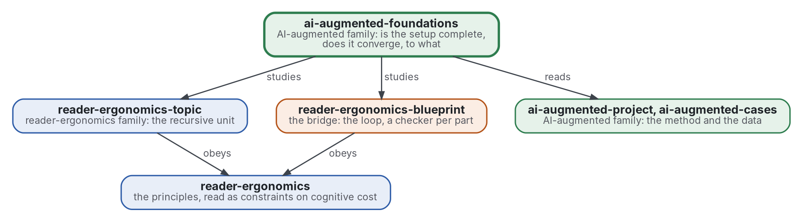

# Fondements du travail augmenté par l'IA

[](https://github.com/Tewf/ai-augmented-foundations/actions/workflows/checks.yml)
[](https://tewf.github.io/ai-augmented-foundations/)

Si le dispositif de la famille est **complet** et s'il **converge**. Complet : un arbre ou un graphe de topics peut-il
encoder tout problème qu'un projet rencontre, à un coût cognitif qu'une personne supporte ? Converge : à quelle vitesse
un projet mené ainsi atteint un résultat, lequel, un résultat acceptable ou l'optimum, et ce que la famille entend par
optimum. Les membres tiennent la méthode ; ce dépôt l'étudie avec les outils de la logique, de la complexité et de l'optimisation.

Cette page en anglais : [README.md](README.md). Les deux versions suivent le même état.

> **État (2026-11-03) :** version 0.1.0. Construit : la première revue de littérature, en deux topics (43 sources
> nouvelles et 6 reprises de revues sœurs, lues par résumé ou notice) avec ses références nommées, un coût candidat d'un
> arbre de topics calculé sur les huit arbres de la famille, trois principes chacun avec une vérification, et 49 tests
> unitaires des deux vérifications. Ouvert : rien ne valide le coût candidat, l'écart à l'optimum est calculé sur trois
> exécutions enregistrées dont aucune n'est marquée acceptée, et il n'y a pas encore de forme. Le nom reste
> provisoire : la revue a trouvé que le domaine dit puissance d'expression et arrêt anytime, non complet et converge, et
> ne propose aucun renommage. Ce n'est ni une norme officielle, ni une étude relue par des pairs, ni un résultat
> nouveau.
>
> **Comment il est fait :** avec Claude, un assistant IA d'Anthropic, sous la direction du mainteneur, comme
> reader-ergonomics. Les corrections sont bienvenues sous forme d'issues.

## L'adopter

Dix minutes, sans lire les revues. La forme générale est la section « Take your own version » de
[reader-ergonomics](https://github.com/Tewf/reader-ergonomics/blob/4f99372093729dacf982e9174e94f6b8793c513d/README.md#take-your-own-version) ; la voici pour mesurer un arbre de topics.

1. **Épingler la norme par son commit**, pour que ses vérifications ne changent pas sous vos pieds :
   `git clone https://github.com/Tewf/reader-ergonomics && git -C reader-ergonomics checkout 4f99372` (v1.20.0).
2. **Copier ce dont vous avez besoin, une fois :** les deux vérifications de [checks/local/](checks/local/)
   (`topic_cost.py`, `optimality_gap.py`) dans le `checks/local/` de votre dépôt, et les [principes](principles/) que
   vous adoptez. Il n'y a pas de forme ici ; l'unité est le fichier de principe. Les copies sont à vous ; notez le commit
   d'où vous les avez prises.
3. **Configurer** avec un `checks/config.toml` qui étend la norme et recopie les tables `[topic_cost]` et
   `[optimality_gap]` de [celui-ci](checks/config.toml) ; chaque valeur y est marquée PROVISIONAL, gardez la marque :

   ```toml
   extends = "reader-ergonomics"
   ```

4. **Lancer les vérifications** depuis le dossier de votre dépôt : `python3 reader-ergonomics/checks/run.py .`
   Pour afficher le coût de n'importe quel arbre de topics : `python3 checks/local/topic_cost.py chemin/vers/le/depot`.
5. **Désaccord :** ouvrez une issue sur ce dépôt, avec la preuve. Une règle de la norme elle-même va aux issues de
   reader-ergonomics ; une préférence de votre lecteur va dans un style de lecteur, comme dérogation.

## Où il se place


<details>
<summary>Graphviz source</summary>



</details>

- **Il étudie [reader-ergonomics-topic](https://github.com/Tewf/reader-ergonomics-topic/blob/86e14fe9a1a9877d6a87a2f8b4e8713f98724b5a/shapes/topic.md)** (v0.6.1), dont la revue des modèles de nœud
  ouvre la question de l'expressivité, et **[reader-ergonomics-blueprint](https://github.com/Tewf/reader-ergonomics-blueprint)**, la boucle dont la convergence est demandée.
- **Il obéit à [reader-ergonomics](https://github.com/Tewf/reader-ergonomics/blob/4f99372093729dacf982e9174e94f6b8793c513d/standard.md)** (v1.20.0) et exécute ses vérifications en CI.
- **Il ne pointe que vers le bas.** Les données dont il a besoin viennent d'[ai-augmented-cases](https://github.com/Tewf/ai-augmented-cases) ;
  la carte de la famille est [ai-augmented](https://github.com/Tewf/ai-augmented).

## Périmètre

| | Quoi | Pourquoi |
|---|---|---|
| dedans | l'expressivité : ce qu'un arbre, ou un graphe, de topics peut et ne peut pas encoder, énoncé formellement | « tout problème » est une affirmation à prouver ou à borner, pas à supposer |
| dedans | le coût cognitif : les principes de la norme lus comme contraintes, et une mesure de coût qu'un programme calcule | expressif et illisible ne vaut pas mieux que lisible et incomplet |
| dedans | la convergence : à quelle vitesse un projet atteint un résultat, et quand il s'arrête ; satisfaction (satisficing), algorithmes anytime, règles d'arrêt | des projets convergent vite vers un résultat acceptable, d'autres n'atteignent jamais l'optimum, et la différence n'a pas de nom |
| dedans | l'optimum : ce que la famille entend par là, à plusieurs objectifs, et ce que dit la seule optimisation exacte déjà menée | un optimum exact des conventions a éparpillé des fichiers que personne ne voulait épars ; acceptable et optimal diffèrent |
| dehors | recueillir les données | [ai-augmented-cases](https://github.com/Tewf/ai-augmented-cases) |
| dehors | le gabarit du topic et sa vérification | [reader-ergonomics-topic](https://github.com/Tewf/reader-ergonomics-topic) |
| dehors | la méthode | [ai-augmented-project](https://github.com/Tewf/ai-augmented-project) |

## Le premier travail : une revue de littérature

Écrit, en première passe sur deux topics : [expressiveness](evidence/expressiveness/) et [convergence](evidence/convergence/).
Chacun suit les cinq étapes d'une revue de thèse (cadrage, revue, état de l'art, positionnement, référence) et finit sur
sa référence. La bibliographie est [evidence/bibliography.md](evidence/bibliography.md).

## Ce que la revue a trouvé

1. **Complet est trivial tant que le contenu n'est pas typé.** Un arbre plus m moins n plus c arêtes de référence
   encode tout graphe fini. Un seul topic qui contient tout le texte encode n'importe quoi. La vraie question est
   quelles vérifications un programme peut faire sur la partie typée ; la décomposition hiérarchique a des classes de
   langages formels (Höller 2014). Aucun problème qui n'ait besoin ni d'arbre ni de graphe n'a été trouvé.
2. **Aucun coût d'un arbre de topics n'est validé.** Pour le code, 121 métriques n'ont pas capté la compréhensibilité
   (Scalabrino 2021), et un seul décompte, Cognitive Complexity, corrèle avec le temps de compréhension (Muñoz Barón
   2020). Qu'un décompte d'imbrication prédise l'effort d'un lecteur sur des topics n'est pas testé. Les échelles de charge
   déclarée sont fiables, mais une méta-analyse de 2022 trouve leur validité en partie contredite (Krieglstein 2022). Un premier candidat, quatre
   composantes combinées comme Cognitive Complexity combine imbrication et ruptures, est [calculé sur la famille](evidence/expressiveness/cost-on-the-family.md)
   et non validé ; la profondeur fournit l'essentiel de sa valeur.
3. **Le domaine a le cadre de la convergence.** La satisfaction (satisficing), l'optimalité bornée et les algorithmes
   anytime donnent la qualité en fonction du temps et l'arrêt comme décision. Aucune source ne les applique à la
   structure d'une collection de documents.
4. **L'optimum exact et l'arbre accepté diffèrent par nature.** Dans l'exécution du mainteneur, l'optimum était groupé
   par produit et l'arbre du propriétaire par étape. Pour le code, Candela 2016 demande si les développeurs visent l'optimum cohésion-couplage. S'arrêter
   à l'acceptable, et se servir de l'optimum comme borne.
5. **Un programme peut tester « fini »** comme un critère écrit plus une tolérance sur l'écart d'optimalité. Des règles d'arrêt existent
   avec un échantillon (Correa 2023) ou sur des tâches répétées (Svegliato 2020 ; Sung 2021). Aucune n'a été trouvée
   pour une seule exécution à loi inconnue de ce que le prochain changement apporte.

## La référence

- **Expressiveness :** un arbre avec des arêtes de référence, comme les cartes DITA et SKOS ; la classe de langage de la
  décomposition ; Cognitive Complexity comme coût à battre ([référence](evidence/expressiveness/baseline.md)).
- **Convergence :** l'optimisation exacte du mainteneur, mise par écrit pour cette revue, avec ses résultats. Elle est
  comparée au coût de Dasgupta par liaison moyenne, à la qualité de modularisation, à un front de Pareto et à un coût borné en profondeur
  ([référence](evidence/convergence/baseline.md)).

## Questions auxquelles la revue doit répondre

- **Expressivité.** Un énoncé formel de ce qu'un arbre de topics encode, et de ce qui exige un graphe ; existe-t-il un
  problème qui n'exige ni l'un ni l'autre et n'entre dans rien ?
- **Coût.** Une mesure de coût cognitif qu'un programme calcule à partir d'un arbre de topics, et son grade de preuve.
  Répondu en partie : une [mesure candidate](decisions/0003-a-candidate-cost-of-a-tree-of-topics.md), grade non trouvé.
- **Acceptable ou optimal.** Ce que l'optimisation exacte déjà menée dit de l'écart entre l'optimum et ce que les gens
  acceptent, et auquel des deux un projet devrait s'arrêter.
- **Fini.** Ce que la famille appellera « fini » pour un projet, et si un programme peut le dire.

## Vérifier

```sh
git clone https://github.com/Tewf/reader-ergonomics && git -C reader-ergonomics checkout 4f99372
python3 reader-ergonomics/checks/run.py chemin/vers/ce/depot
```

La CI exécute d'abord les tests unitaires des deux vérifications, puis les mêmes vérifications, à chaque push, et une exécution échoue à la première erreur
([checks.yml](https://github.com/Tewf/ai-augmented-foundations/blob/master/.github/workflows/checks.yml)). Chaque push
sur master construit aussi le site, [tewf.github.io/ai-augmented-foundations](https://tewf.github.io/ai-augmented-foundations/)
([pages.yml](https://github.com/Tewf/ai-augmented-foundations/blob/master/.github/workflows/pages.yml)).

## Contenu

| Partie | Résumé |
|---|---|
| [standard.md](standard.md) | la fiche : les trois principes que les revues ont gradués, chacun avec son grade, ses preuves et sa vérification |
| [principles](principles/) | un fichier par principe, en deux groupes : expressiveness et convergence |
| [evidence](evidence/) | la première revue en deux topics, expressiveness et convergence, le coût candidat sur la famille, et la bibliographie |
| [checks](checks/) | la config et les vérifications locales `topic-cost` et `optimality-gap`, avec leurs tests unitaires |
| [decisions](decisions/) | une fiche par choix qui façonne ce dépôt, chacune ouvrant sur la décision en une phrase |

## Licence

Code sous [Apache License 2.0](LICENSE) ; prose sous [CC BY 4.0](LICENSES/CC-BY-4.0.txt). Réutilisez-le comme vous le
souhaitez, en créditant ce dépôt ; [CITATION.cff](CITATION.cff) donne une citation si besoin.
