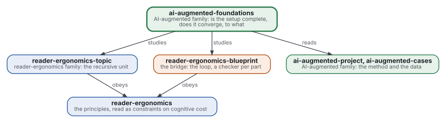
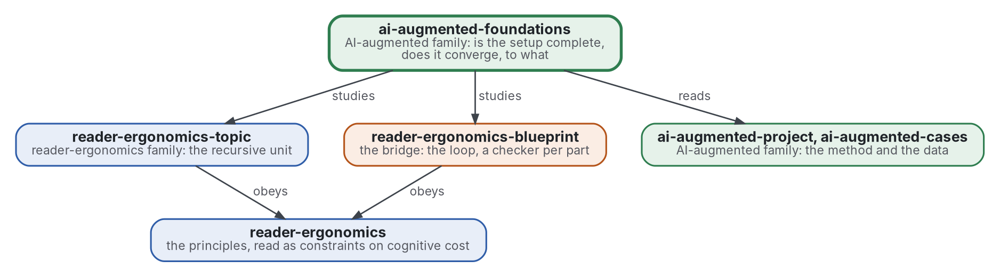

# Fondements du travail augmenté par l'IA

[](https://github.com/Tewf/ai-augmented-foundations/actions/workflows/checks.yml)
[](https://tewf.github.io/ai-augmented-foundations/)

Si le dispositif de la famille est **complet** et s'il **converge**. Complet : un arbre ou un graphe de topics peut-il
encoder tout problème qu'un projet rencontre, à un coût cognitif qu'une personne supporte ? Converge : à quelle vitesse
un projet mené ainsi atteint un résultat, lequel, un résultat acceptable ou l'optimum, et ce que la famille entend par
optimum. Les membres tiennent la méthode ; ce dépôt l'étudie avec les outils de la logique, de la complexité et de l'optimisation.

Cette page en anglais : [README.md](README.md). Les deux versions suivent le même état.

> **État (2026-11-02) :** mis en place ; rien n'est encore écrit au-delà du périmètre. Le premier travail est une revue
> de littérature, non commencée. Le nom est provisoire jusqu'à ce que la première étape de cette revue dise comment le
> domaine nomme la chose. Ce n'est ni une norme officielle, ni une étude relue par des pairs, ni un résultat nouveau.
>
> **Comment il est fait :** avec Claude, un assistant IA d'Anthropic, sous la direction du mainteneur, comme
> reader-ergonomics. Les corrections sont bienvenues sous forme d'issues.

## Où il se place



<details>
<summary>Graphviz source</summary>



</details>

- **Il étudie [reader-ergonomics-topic](https://github.com/Tewf/reader-ergonomics-topic/blob/86e14fe9a1a9877d6a87a2f8b4e8713f98724b5a/shapes/topic.md)** (v0.6.1), dont la revue des modèles de nœud
  ouvre la question de l'expressivité, et **[reader-ergonomics-blueprint](https://github.com/Tewf/reader-ergonomics-blueprint)**, la boucle dont la convergence est demandée.
- **Il obéit à [reader-ergonomics](https://github.com/Tewf/reader-ergonomics/blob/b9732b9814c71768f722691f3c5049ec2b8ed378/standard.md)** (v1.19.2) et exécute ses vérifications en CI.
- **Il ne pointe que vers le bas.** Les données dont il a besoin viennent d'[ai-augmented-cases](https://github.com/Tewf/ai-augmented-cases) ;
  la carte de la famille est [ai-augmented](https://github.com/Tewf/ai-augmented).

## Périmètre

| | Quoi | Pourquoi |
|---|---|---|
| dedans | l'expressivité : ce qu'un arbre, ou un graphe, de topics peut et ne peut pas encoder, énoncé formellement | « tout problème » est une affirmation à prouver ou à borner, pas à supposer |
| dedans | le coût cognitif : les principes de la norme lus comme contraintes, et une mesure de coût qu'un programme calcule | expressif et illisible ne vaut pas mieux que lisible et incomplet |
| dedans | la convergence : à quelle vitesse un projet atteint un résultat, et quand il s'arrête ; satisfaction (satisficing), algorithmes anytime, règles d'arrêt | des projets convergent vite vers un résultat acceptable, d'autres n'atteignent jamais l'optimum, et la différence n'a pas de nom |
| dedans | l'optimum : ce que la famille entend par là, à plusieurs objectifs, et ce que dit la seule optimisation exacte déjà menée | un optimum exact des conventions a éparpillé des fichiers que personne ne voulait épars ; acceptable et optimal diffèrent |
| dehors | recueillir les données | [ai-augmented-cases](https://github.com/Tewf/ai-augmented-cases) |
| dehors | le gabarit du topic et sa vérification | [reader-ergonomics-topic](https://github.com/Tewf/reader-ergonomics-topic) |
| dehors | la méthode | [ai-augmented-project](https://github.com/Tewf/ai-augmented-project) |

## Le premier travail : une revue de littérature

Non commencée. Elle suit l'ordre d'une revue de thèse, et elle est finie quand elle peut nommer la référence.

1. **Cadrer :** les deux problèmes en une phrase chacun, et comment chaque domaine les nomme. Pistes à vérifier :
   expressivité des modèles de document hiérarchiques et en graphe, charge cognitive, rationalité limitée et
   satisfaction, arrêt optimal, algorithmes anytime, optimisation multi-objectif. Le dépôt peut être renommé alors.
2. **Revue :** chaque nom, cherché par son nom académique, son acronyme et son auteur ; les synthèses d'abord.
   - ce que la revue des modèles de nœud du topic tient déjà : graphes ET-OU, hypergraphes, réseaux de tâches, schémas d'argumentation ;
   - l'expressivité formelle des encodages de problèmes en arbre et en graphe, et leurs limites connues ;
   - la charge cognitive et le coût de la profondeur, que reader-ergonomics grade déjà ;
   - la satisfaction, les règles d'arrêt et les algorithmes anytime : quand arrêter la recherche d'un résultat ;
   - l'optimisation multi-objectif : ce qu'est un optimum quand lecteurs, auteurs et vérificateurs veulent des choses différentes.
3. **État de l'art, et le dossier contre.**
4. **Positionnement :** ce que ce dépôt demande et que le domaine ne répond pas déjà.
5. **Référence :** la seule optimisation exacte déjà menée sur les conventions, avec son résultat, contre la meilleure
   formulation trouvée par la revue.

## Questions auxquelles la revue doit répondre

- **Expressivité.** Un énoncé formel de ce qu'un arbre de topics encode, et de ce qui exige un graphe ; existe-t-il un
  problème qui n'exige ni l'un ni l'autre et n'entre dans rien ?
- **Coût.** Une mesure de coût cognitif qu'un programme calcule à partir d'un arbre de topics, et son grade de preuve.
- **Acceptable ou optimal.** Ce que l'optimisation exacte déjà menée dit de l'écart entre l'optimum et ce que les gens
  acceptent, et auquel des deux un projet devrait s'arrêter.
- **Fini.** Ce que la famille appellera « fini » pour un projet, et si un programme peut le dire.

## Vérifier

```sh
git clone https://github.com/Tewf/reader-ergonomics
python3 reader-ergonomics/checks/run.py chemin/vers/ce/depot
```

La CI exécute les mêmes vérifications à chaque push, et une exécution échoue à la première erreur
([checks.yml](https://github.com/Tewf/ai-augmented-foundations/blob/master/.github/workflows/checks.yml)). Chaque push
sur master construit aussi le site, [tewf.github.io/ai-augmented-foundations](https://tewf.github.io/ai-augmented-foundations/)
([pages.yml](https://github.com/Tewf/ai-augmented-foundations/blob/master/.github/workflows/pages.yml)).

## Contenu

| Partie | Résumé |
|---|---|
| [decisions](decisions/) | une fiche par choix qui façonne ce dépôt, chacune ouvrant sur la décision en une phrase |

## Licence

Code sous [Apache License 2.0](LICENSE) ; prose sous [CC BY 4.0](LICENSES/CC-BY-4.0.txt). Réutilisez-le comme vous le
souhaitez, en créditant ce dépôt ; [CITATION.cff](CITATION.cff) donne une citation si besoin.
