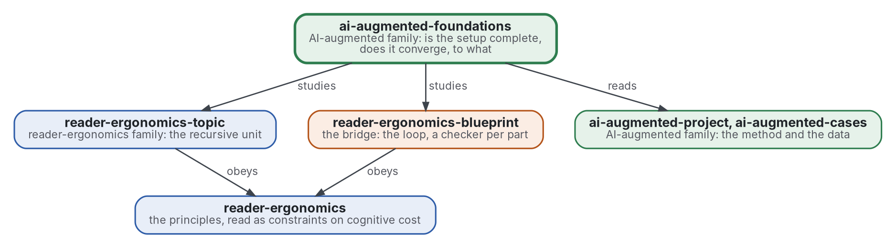

# AI-augmented foundations

[](https://github.com/Tewf/ai-augmented-foundations/actions/workflows/checks.yml)
[](https://tewf.github.io/ai-augmented-foundations/)

Whether the family's setup is **complete** and whether it **converges**. Complete: can a tree or graph of topics
encode every problem a project meets, at a cognitive cost a person bears? Converges: how fast does a project run this
way reach a result, which result, an acceptable one or the optimum, and what the family means by an optimum at all.
The members hold the method; this repository studies it with the tools of logic, complexity and optimisation.

This page in French: [README.fr.md](README.fr.md).

> **Status (2026-11-02):** set up; nothing is written yet beyond the scope. The first job is a literature review, not
> started. The name is provisional until that review's first step says what the field calls this. It is not an
> official standard, not a peer-reviewed study and not a new result.
>
> **How it is made:** with Claude, an AI assistant by Anthropic, under the maintainer's direction, the way
> reader-ergonomics was made. Corrections are welcome as issues.

## Where it sits


<details>
<summary>Graphviz source</summary>



</details>

- **It studies [reader-ergonomics-topic](https://github.com/Tewf/reader-ergonomics-topic/blob/86e14fe9a1a9877d6a87a2f8b4e8713f98724b5a/shapes/topic.md)** (v0.6.1), whose review of node models is the start
  of the expressiveness question, and **[reader-ergonomics-blueprint](https://github.com/Tewf/reader-ergonomics-blueprint)**, the loop whose convergence is asked.
- **It obeys [reader-ergonomics](https://github.com/Tewf/reader-ergonomics/blob/b9732b9814c71768f722691f3c5049ec2b8ed378/standard.md)** (v1.19.2) and runs its checks in CI.
- **It links down only.** The data it needs comes from [ai-augmented-cases](https://github.com/Tewf/ai-augmented-cases);
  the family's map is [ai-augmented](https://github.com/Tewf/ai-augmented).

## Scope

| | What | Why |
|---|---|---|
| in | expressiveness: what a tree, or a graph, of topics can and cannot encode, stated formally | "every problem" is a claim to prove or to bound, not to assume |
| in | cognitive cost: the standard's principles read as constraints, and a measure of cost a program can compute | expressive and unreadable is no better than readable and incomplete |
| in | convergence: how fast a project reaches a result, and when it stops; satisficing, anytime algorithms, stopping rules | some projects converge fast to an acceptable result, some never reach the optimum, and the difference is not named |
| in | the optimum: what the family means by it, with several objectives, and what the one exact optimisation already run says | an exact optimum of the conventions scattered files nobody wanted scattered; acceptable and optimal differ |
| out | collecting the data | [ai-augmented-cases](https://github.com/Tewf/ai-augmented-cases) |
| out | the topic template and its check | [reader-ergonomics-topic](https://github.com/Tewf/reader-ergonomics-topic) |
| out | the method | [ai-augmented-project](https://github.com/Tewf/ai-augmented-project) |

## The first job: a literature review

Not started. It follows the order of a thesis review, and it is finished when it can name the baseline.

1. **Frame:** the two problems in one sentence each, and what each field calls them. Leads to verify: expressiveness
   of hierarchical and graph document models, cognitive load, bounded rationality and satisficing, optimal stopping,
   anytime algorithms, multi-objective optimisation. The repository may be renamed then.
2. **Review:** each name, searched by its academic name, its acronym and its author; surveys first.
   - what the topic's node-model review already holds: AND-OR graphs, hypergraphs, task networks, argument schemes;
   - formal expressiveness of tree and graph encodings of problems, and their known limits;
   - cognitive load and the cost of depth, what reader-ergonomics already grades;
   - satisficing, stopping rules and anytime algorithms: when to stop a search for a result;
   - multi-objective optimisation: what an optimum is when readers, writers and checkers want different things.
3. **State of the art, and the case against.**
4. **Position:** what this repository asks that the field does not already answer.
5. **Baseline:** the one exact optimisation already run on the conventions, with its result, against the best
   formulation the review found.

## Questions the review must answer

- **Expressiveness.** A formal statement of what a tree of topics encodes, and what needs a graph; is there a problem
  that needs neither and fits nothing?
- **Cost.** A measure of cognitive cost a program can compute from a tree of topics, and its grade of evidence.
- **Acceptable or optimal.** What the exact optimisation already run says about the gap between the optimum and
  what people accept, and which of the two a project should stop at.
- **Done.** What the family will call "done" for a project, and whether a program can tell.

## Check it

```sh
git clone https://github.com/Tewf/reader-ergonomics
python3 reader-ergonomics/checks/run.py path/to/this/repository
```

CI runs the same checks on every push, and a run fails on any error
([checks.yml](https://github.com/Tewf/ai-augmented-foundations/blob/master/.github/workflows/checks.yml)). Every push
to master also renders the site, [tewf.github.io/ai-augmented-foundations](https://tewf.github.io/ai-augmented-foundations/)
([pages.yml](https://github.com/Tewf/ai-augmented-foundations/blob/master/.github/workflows/pages.yml)).

## Contents

| Part | Summary |
|---|---|
| [decisions](decisions/) | one record per choice that shapes this repository, each opening with the decision in one sentence |

## Licence

Code under the [Apache License 2.0](LICENSE); prose under [CC BY 4.0](LICENSES/CC-BY-4.0.txt). Reuse it as you wish,
with credit to this repository; [CITATION.cff](CITATION.cff) gives a citation if you need one.
