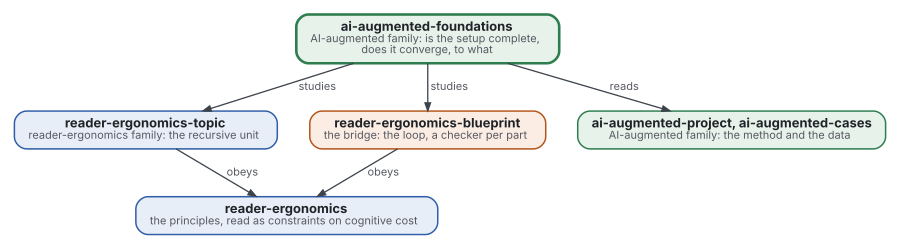
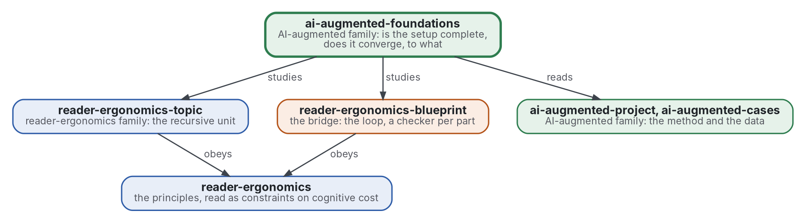

# AI-augmented foundations

[](https://github.com/Tewf/ai-augmented-foundations/actions/workflows/checks.yml)
[](https://tewf.github.io/ai-augmented-foundations/)

Whether the family's setup is **complete** and whether it **converges**. Complete: can a tree or graph of topics
encode every problem a project meets, at a cognitive cost a person bears? Converges: how fast does a project run this
way reach a result, which result, an acceptable one or the optimum, and what the family means by an optimum at all.
The members hold the method; this repository studies it with the tools of logic, complexity and optimisation.

This page in French: [README.fr.md](README.fr.md).

> **Status (2026-11-03):** version 0.1.0. Built: the first literature review, in two topics (43 new sources and 6
> linked from sibling reviews, read by abstract or record) with its baselines named, a candidate cost of a tree of
> topics computed on the family's eight trees, three principles each with a check, and 49 unit tests of the two checks.
> Open: nothing validates the candidate cost, the optimality gap is computed on three recorded runs and none is marked
> accepted, and there are no shapes yet. The name is still provisional: the review found that the field says
> expressive power and anytime stopping, not complete and converges, and proposes no rename. It is not an official
> standard, not a peer-reviewed study and not a new result.
>
> **How it is made:** with Claude, an AI assistant by Anthropic, under the maintainer's direction, the way
> reader-ergonomics was made. Corrections are welcome as issues.

## Take it

Ten minutes, without reading the reviews. The general form is reader-ergonomics'
[Take your own version](https://github.com/Tewf/reader-ergonomics/blob/b9732b9814c71768f722691f3c5049ec2b8ed378/README.md#take-your-own-version); here it is for measuring a tree of topics.

1. **Pin the standard by commit**, so its checks do not change under you:
   `git clone https://github.com/Tewf/reader-ergonomics && git -C reader-ergonomics checkout b9732b9` (v1.19.2).
2. **Copy what you need, once:** the two checks in [checks/local/](checks/local/) (`topic_cost.py`,
   `optimality_gap.py`) into your repository's `checks/local/`, and the [principles](principles/) you adopt. There is no
   shape here; the unit is the principle file. The copies are yours; note the commit you copied from.
3. **Configure** with a `checks/config.toml` that extends the standard and copies the `[topic_cost]` and
   `[optimality_gap]` tables of [this one](checks/config.toml); every value there is tagged PROVISIONAL, so keep the tag:

   ```toml
   extends = "reader-ergonomics"
   ```

4. **Run the checks** from the folder of your repository: `python3 reader-ergonomics/checks/run.py .`
   To print the cost of any tree of topics: `python3 checks/local/topic_cost.py path/to/repository`.
5. **Disagree** by opening an issue on this repository, with the evidence. A rule of the standard itself goes to
   reader-ergonomics' issues; a preference of your own reader goes in a reader style as an override.

## Where it sits



<details>
<summary>Graphviz source</summary>



</details>

- **It studies [reader-ergonomics-topic](https://github.com/Tewf/reader-ergonomics-topic/blob/86e14fe9a1a9877d6a87a2f8b4e8713f98724b5a/shapes/topic.md)** (v0.6.1), whose review of node models is the start
  of the expressiveness question, and **[reader-ergonomics-blueprint](https://github.com/Tewf/reader-ergonomics-blueprint)**, the loop whose convergence is asked.
- **It obeys [reader-ergonomics](https://github.com/Tewf/reader-ergonomics/blob/b9732b9814c71768f722691f3c5049ec2b8ed378/standard.md)** (v1.19.2) and runs its checks in CI.
- **It links down only.** The data it needs comes from [ai-augmented-cases](https://github.com/Tewf/ai-augmented-cases);
  the family's map is [ai-augmented](https://github.com/Tewf/ai-augmented).

## Scope

| | What | Why |
|---|---|---|
| in | expressiveness: what a tree, or a graph, of topics can and cannot encode, stated formally | "every problem" is a claim to prove or to bound, not to assume |
| in | cognitive cost: the standard's principles read as constraints, and a measure of cost a program can compute | expressive and unreadable is no better than readable and incomplete |
| in | convergence: how fast a project reaches a result, and when it stops; satisficing, anytime algorithms, stopping rules | some projects converge fast to an acceptable result, some never reach the optimum, and the difference is not named |
| in | the optimum: what the family means by it, with several objectives, and what the one exact optimisation already run says | an exact optimum of the conventions scattered files nobody wanted scattered; acceptable and optimal differ |
| out | collecting the data | [ai-augmented-cases](https://github.com/Tewf/ai-augmented-cases) |
| out | the topic template and its check | [reader-ergonomics-topic](https://github.com/Tewf/reader-ergonomics-topic) |
| out | the method | [ai-augmented-project](https://github.com/Tewf/ai-augmented-project) |

## The first job: a literature review

Written, as a first pass of two topics: [expressiveness](evidence/expressiveness/) and [convergence](evidence/convergence/).
Each follows the five steps of a thesis review (frame, review, state of the art, position, baseline) and ends on its
baseline. The bibliography is [evidence/bibliography.md](evidence/bibliography.md).

## What the review found

1. **Complete is trivial until content is typed.** A tree plus m minus n plus c reference edges encodes any finite
   graph, and one topic holding all the text encodes anything. The real question is which checks a program can run on
   the typed fragment; hierarchical decomposition has formal language classes (Höller 2014). No problem that needs
   neither a tree nor a graph was found.
2. **No cost of a tree of topics has been validated.** For code, 121 metrics failed to capture understandability
   (Scalabrino 2021), and one count, Cognitive Complexity, correlates with comprehension time (Muñoz Barón 2020).
   Whether a nesting count predicts a reader's effort on topics is untested. Self-report load scales are reliable, but a
   2022 meta-analysis finds their validity partly contradicted (Krieglstein 2022). A first candidate, four
   components combined as Cognitive Complexity combines nesting and breaks, is [computed on the family](evidence/expressiveness/cost-on-the-family.md)
   and not validated; depth supplies most of its value.
3. **The field has the frame for convergence.** Satisficing, bounded optimality and anytime algorithms give quality as
   a function of time and stopping as a decision. No source applies them to the structure of a document collection.
4. **The exact optimum and the accepted tree differ in kind.** In the maintainer's own run the optimum was grouped by
   product and the owner's tree by stage. For code, Candela 2016 asks whether developers pursue the cohesion-coupling optimum. Stop at acceptable, and
   use the optimum as a bound.
5. **Done can be tested by a program** as a written criterion plus a tolerance on the optimality gap. Stopping rules exist
   given a sample (Correa 2023) or over repeated tasks (Svegliato 2020; Sung 2021). None was found for one run with an
   unknown distribution of what the next change brings.

## The baseline

- **Expressiveness:** a tree with reference edges, as in DITA maps and SKOS; the language class of the decomposition;
  Cognitive Complexity as the cost to beat ([baseline](evidence/expressiveness/baseline.md)).
- **Convergence:** the maintainer's own exact optimisation, written down for this review, with its results, against
  Dasgupta's cost by average linkage, modularisation quality, a Pareto front and a depth-bounded cost
  ([baseline](evidence/convergence/baseline.md)).

## Questions the review must answer

- **Expressiveness.** A formal statement of what a tree of topics encodes, and what needs a graph; is there a problem
  that needs neither and fits nothing?
- **Cost.** A measure of cognitive cost a program can compute from a tree of topics, and its grade of evidence.
  Answered in part: a [candidate measure](decisions/0003-a-candidate-cost-of-a-tree-of-topics.md), grade not found.
- **Acceptable or optimal.** What the exact optimisation already run says about the gap between the optimum and
  what people accept, and which of the two a project should stop at.
- **Done.** What the family will call "done" for a project, and whether a program can tell.

## Check it

```sh
git clone https://github.com/Tewf/reader-ergonomics && git -C reader-ergonomics checkout b9732b9
python3 reader-ergonomics/checks/run.py path/to/this/repository
```

CI first runs the unit tests of the two checks, then the same checks, on every push, and a run fails on any error
([checks.yml](https://github.com/Tewf/ai-augmented-foundations/blob/master/.github/workflows/checks.yml)). Every push
to master also renders the site, [tewf.github.io/ai-augmented-foundations](https://tewf.github.io/ai-augmented-foundations/)
([pages.yml](https://github.com/Tewf/ai-augmented-foundations/blob/master/.github/workflows/pages.yml)).

## Contents

| Part | Summary |
|---|---|
| [standard.md](standard.md) | the card: the three principles the reviews graded, each with its grade, evidence and check |
| [principles](principles/) | one file per principle, in two groups: expressiveness and convergence |
| [evidence](evidence/) | the first review in two topics, expressiveness and convergence, the candidate cost on the family, and the bibliography |
| [checks](checks/) | the config and the local checks `topic-cost` and `optimality-gap`, with their unit tests |
| [decisions](decisions/) | one record per choice that shapes this repository, each opening with the decision in one sentence |

## Licence

Code under the [Apache License 2.0](LICENSE); prose under [CC BY 4.0](LICENSES/CC-BY-4.0.txt). Reuse it as you wish,
with credit to this repository; [CITATION.cff](CITATION.cff) gives a citation if you need one.
