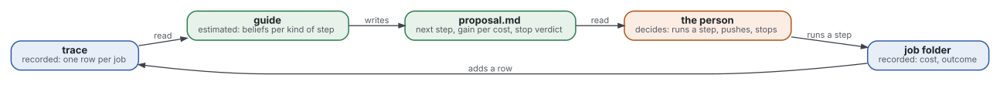

# A guide that proposes the next step of a project

- **Decision asked.** Should the family build a program that proposes which job to run next and when to stop, and never decides? The maintainer decides, after reading the replay in [replay.md](replay.md).
- **Status.** Proposed, 2026-11-03. The verdict is part four and [decision 0006](../decisions/0006-do-not-build-the-guide-yet.md).
- **Shape:** [design document](https://github.com/Tewf/reader-ergonomics-software-design/blob/48b497ba591e9d6ffc962b1d08448930fa8158de/shapes/design-document.md)

**Summary.**

- A project is a sequence of steps taken under an objective nobody can write down.
- The field calls this Bayesian optimisation; this repository's [review](../evidence/bayesian-optimisation/README.md) and [worked model](../evidence/bayesian-optimisation/worked-model.md) gave the frame and a baseline.
- The family's first two days are 36 jobs on record. Replayed, the policies name the kind of job the maintainer chose no more often than chance.
- The recommendation is not to build the guide yet. The record of jobs is the part to keep and to grow.

Terms, defined here before use:

- A **step** is one job: a review, a build, an audit, a design, an experiment, a setup or an upkeep, each a **kind**.
- A **wave** is a cluster of steps launched together.
- An **outcome** of a step is **moved** (a later record names it as the reason for a change that stands) or **kept** (its headline result stands).
- A **trace** is one row per step, with its kind, cost and outcomes.

## Part one: the problem, modelled

A project is a sequential decision problem under an unknown objective. The figure draws it.

```dot
// A project as a sequential decision problem under an unknown objective. Colours: blue what is recorded, green what is
// estimated, orange what the person decides, each named in its box. The dashed edge is the objective moving.
digraph problem_model {
  graph [rankdir=LR, nodesep=0.4, ranksep=0.55, bgcolor="white", pad=0.2, fontname="Inter"];
  node  [shape=box, style="rounded,filled", fontname="Inter", fontsize=13, margin="0.2,0.1", penwidth=1.5, fontcolor="#1F2328"];
  edge  [fontname="Inter", fontsize=11, color="#3D434B", fontcolor="#55575F", penwidth=1.3, arrowsize=0.8];
  S [label=<<b>state s</b><br/><font point-size="11" color="#55575F">recorded: review, runs, cases, tree</font>>, fillcolor="#E8EEF8", color="#2F5DA8"];
  A [label=<<b>action a, with cost c(a)</b><br/><font point-size="11" color="#55575F">a job: review, build, audit, experiment</font>>, fillcolor="#FBEDE4", color="#B4541A"];
  O [label=<<b>observation y</b><br/><font point-size="11" color="#55575F">recorded: a measure, a verdict, an answer</font>>, fillcolor="#E8EEF8", color="#2F5DA8"];
  F [label=<<b>objective f</b><br/><font point-size="11" color="#55575F">unknown; the person's judgment is part of it</font>>, fillcolor="#E6F2EA", color="#2E7D4F", style="rounded,filled,dashed"];
  S -> A [label=" the person chooses"];
  A -> O [label=" run"];
  O -> S [label=" adds a point"];
  A -> F [label=" can change f", style=dashed];
  F -> O [label=" noisy view", style=dashed];
}
```


<details>
<summary>Graphviz source</summary>



</details>

The notation is the review's: a surrogate, an acquisition function, a stopping rule ([frame](../evidence/bayesian-optimisation/frame.md)).

| Part | Symbol | In a project | Cost or noise |
|---|---|---|---|
| State | D_t | the review, the runs, the cases and the tree after t steps | none |
| Action | a_t, in a set A | one step: a kind, aimed at a repository | c(a): tokens, dollars or a person's hour |
| Observation | y_t | a measured value, a verdict of a check, a question answered | noisy; read by an evaluator |
| Objective | f | what the person wants, never written down | unknown |
| Surrogate | p(f given D_t) | the guide's belief about which steps pay | estimated |
| Policy | a_(t+1) = pi(D_t) | which step comes next | the proposal |
| Stop | tau | the step after which no step pays for itself | the verdict |

What a project adds to the textbook problem ([review](../evidence/bayesian-optimisation/review.md), strand 7):

- **The steps change the function.** After a repository has its review, a second review pays less. The function is f_t, not f.
- **The evaluators are agents.** A model that judges a model shows position, verbosity and self-enhancement biases (Zheng 2023b).
- **The objective is partly the person's judgment.** Humans with AI did worse than the better of the two alone (Vaccaro 2024); the person's utility is learned from comparisons, with errors (Astudillo 2020).

**The trace.** The family's first two days are the first dataset: [trace.md](trace.md), 39 rows from the maintainer's log of two days, 36 inside the family.

| Kind | Rows | Tokens (k) | Moved | Of rows with an outcome |
|---|---|---|---|---|
| review | 8 | 1956 | 8 | 8 |
| build | 12 | 4140 | 4 | 12 |
| audit | 4 | 3029 | 2 | 4 |
| experiment | 4 | 920 | 3 | 4 |
| design | 3 | 690 | 2 | 2 |
| setup | 2 | 460 | 0 | 2 |
| upkeep | 3 | 1150 | 0 | 3 |

- **Costs:** two counts are recorded in the log; the others are estimates at 230 thousand tokens a run. The person's time is not recorded.
- **Outcomes:** 19 of 35 steps moved something; 34 of 35 are kept. The one not kept was the first brief test, withdrawn by the second.
- **The gap:** a trace without costs per job and without the person's verdict per job cannot support a surrogate. Part four asks that the log write both.

## Part two: the solutions, mapped

One row per class the review found. The last column says where the class breaks on the family's setup.

| Class | Fits when | In the setup | Breaks when |
|---|---|---|---|
| **Bandit** (UCB1, Thompson sampling; Auer 2002, Russo 2018) | arms are few, cheap and repeatable | the brief test: ten runs of an arm cost cents, so the arm with the best pass rate is found | an arm cannot be repeated: a second review of one repository is not the first again |
| **Expected improvement on a surrogate** (Jones 1998, Snoek 2012) | the steps are points in a space with a smooth objective | the worked model's eight arms, fitted by a Gaussian process | steps are discrete, few and unlike each other; eight points could not fit it |
| **Knowledge gradient** (Frazier 2009) | what a step buys is information, not reward | choosing the arm to measure before a delegation is repeated 200 times | the step also produces an artifact that is kept, as every build does |
| **Multi-fidelity** (Kandasamy 2016, Li 2018) | a cheap evaluator predicts a dear one | a small model before a large one; a program before a person; the brief test before a build | the cheap evaluator is biased in a way the dear one is not: visible tests passed, hidden tests failed (in the [agents repository](https://github.com/Tewf/ai-augmented-agents) the shown cases passed 42 of 60 and the hidden cases 29 of 60 for the same arm) |
| **Cost-aware acquisition** (Snoek 2012, Lee 2020, Xie 2024) | costs differ by orders of magnitude | a program costs nothing, an agent a quarter of a million tokens, a review by the person an hour | the hour is not on the same scale as the token, and the trace does not record it |
| **Value of information for stopping** (Howard 1966, Makarova 2022) | a surrogate gives the distribution of the next gain | stop when the gain over the jobs to come is below the cost of a step | the future count is a guess, and the surrogate is only as good as the rows |
| **Preference-based optimisation** (Astudillo 2020) | the utility can only be compared | the person picks between two proposals | it needs many comparisons; the family has a handful |

- **Where the setup fits best:** cheap arms with a program as the judge. The brief test and the method comparison are bandit problems, and the worked model already treats them so.
- **Where it breaks most:** dear steps. A review or a build is taken once, its gain depends on the state, and its judge is a person.
- **Screening** works as multi-fidelity: a program before a model, a model before a person. It is the existing practice, with the tests as the oracle, written in the field's words.

## Part three: the guide, designed

**Goals.**

- Propose the next step and its expected gain per unit cost, from the trace.
- Write a stop verdict, so that the person knows when more steps no longer pay.
- Make the cost of a proposal low for the person: one file, in the brief's words.

**Non-goals.**

- It does not run a step, push, or decide. The person does.
- It does not set the objective. The outcome of a step is the person's call.
- It does not replace the maintainer's practice (baseline B1) until it beats it on a record.

**Design.** The figure draws what the guide reads, writes and never does.

```dot
// What the guide reads, writes and never does. Colours: blue what is recorded, green what the guide estimates, orange
// what only the person does, each named in its box.
digraph guide_boundary {
  graph [rankdir=LR, nodesep=0.4, ranksep=0.5, bgcolor="white", pad=0.2, fontname="Inter"];
  node  [shape=box, style="rounded,filled", fontname="Inter", fontsize=13, margin="0.2,0.1", penwidth=1.5, fontcolor="#1F2328"];
  edge  [fontname="Inter", fontsize=11, color="#3D434B", fontcolor="#55575F", penwidth=1.3, arrowsize=0.8];
  T [label=<<b>trace</b><br/><font point-size="11" color="#55575F">recorded: one row per job</font>>, fillcolor="#E8EEF8", color="#2F5DA8"];
  G [label=<<b>guide</b><br/><font point-size="11" color="#55575F">estimated: beliefs per kind of step</font>>, fillcolor="#E6F2EA", color="#2E7D4F"];
  P [label=<<b>proposal.md</b><br/><font point-size="11" color="#55575F">next step, gain per cost, stop verdict</font>>, fillcolor="#E6F2EA", color="#2E7D4F"];
  M [label=<<b>the person</b><br/><font point-size="11" color="#55575F">decides: runs a step, pushes, stops</font>>, fillcolor="#FBEDE4", color="#B4541A"];
  J [label=<<b>job folder</b><br/><font point-size="11" color="#55575F">recorded: cost, outcome</font>>, fillcolor="#E8EEF8", color="#2F5DA8"];
  T -> G [label=" read"];
  G -> P [label=" writes"];
  P -> M [label=" read"];
  M -> J [label=" runs a step"];
  J -> T [label=" adds a row"];
}
```



<details>
<summary>Graphviz source</summary>



</details>

- **Inputs:** the trace rows, which come from each job folder's brief and notes; the cases' measures (commits, records, stalls); and the cost of each step. The outcome fields are filled by the person, or by a program that applies a rule the person wrote.
- **The surrogate:** a Beta belief per kind of step, as in [replay.py](../guide/replay.py). With more than a hundred rows, a Gaussian process over the kind and the state of the repository, as in the [worked model](../evidence/bayesian-optimisation/worked_model.py).
- **The menu:** generated from the state. A build is offered only when a design exists; a review only for a repository without one.
- **The proposal:** one file, `proposal.md`, in the four headings of the family's [brief](https://github.com/Tewf/ai-augmented-project/blob/58e62c41a21bb559fea36aa4e66dcd0bb2fc57eb/shapes/brief.md):

```markdown
# Proposal: <the next step>
## Task
<the step, one sentence, with its kind and target>
## Decided
<its expected cost, its expected gain per unit cost, the policy that chose it, the rows it rests on>
## To find
<what the step would teach, and the stop verdict: go on, or stop with the gain and the cost>
## Checks
<how the person or a program will judge the outcome: moved, kept>
```

- **Where it writes:** a file the person reads, in the job folder of the project. It overwrites nothing else.
- **What it must never do:** run a step, push, change a row's outcome, contact a service, or propose a step outside the menu.
- **The stop:** the value-of-information rule of [decision 0005](../decisions/0005-the-project-as-optimisation-of-an-unknown-objective.md), computed on the rows, with the count of jobs to come given by the person.

**Alternatives.**

| Option | Consequences | Why it lost |
|---|---|---|
| The maintainer's practice (baseline B1) | free, tuned to the person; nothing written down | it stays the comparison; the guide must beat it on a record |
| A guide that decides and runs steps | saves the person's time | the objective is the person's judgment, and people with AI did worse than the better alone (Vaccaro 2024) |
| A Gaussian process over the state, now | the field's baseline, reference code exists (BoTorch) | 36 rows and no state variables: eight points already failed to fit |
| A language model that proposes from the trace | fast, readable | judges show biases (Zheng 2023b), and a number the person can check is the point of the guide |
| A dashboard of the meter only | cheap | it shows cost and not gain, so it cannot propose |
| A bandit per repository | each repository has its own arms | a repository has few steps, so each belief has one or two rows |

**Consequences.**

- **Drawbacks:** the outcomes need a rule or a person; the cost of recording them falls on the maintainer.
- **Risks:** a policy that proposes a review every time, as the replay's did, would be followed by a person who knows better, and ignored.
- **Security:** none; the guide reads files and writes one.

**Feasibility and plan.** Shown by [the replay](replay.md), on [the trace](trace.md), with 36 tests. The replay hits 1 of 7 for three policies, 3 of 7 for UCB1, and 2.7 expected for chance. It shows the guide would not yet have helped.

**Open questions.**

- Does a menu generated from the state change the replay? Not tested.
- Does the person's judgment per step, recorded at the time, agree with the writer's reading of the log?
- What is the cost of the person's hour in tokens?

## Part four: the verdict

**Do not build the guide yet. Keep the trace, and grow it.** The reasons:

- **The replay does not beat chance.** Three policies hit once in seven waves, chance hits 2.7, and the one that did better (UCB1, 3) explores unrun kinds, which is not a prediction.
- **The best kind is always a review.** Every review in the trace moved something, so a stationary belief proposes a review at every wave. The maintainer ran none from wave 2 to 6, because a second review of the same repository pays less.
- **The stop fired at wave 2** because the data could not separate kinds, not because the project was done.
- **The proxy is the writer's reading.** No outcome in the trace is the person's judgment at the time.

What to do instead, in [decision 0006](../decisions/0006-do-not-build-the-guide-yet.md):

- **Write one trace row per job**, at its close: kind, agents, tokens, outcome moved and kept, as [guide/trace.toml](../guide/trace.toml) does.
- **Rerun the replay** after about thirty more rows with the person's verdicts.
- **The bar:** at least 5 hits in 7 for one policy, on both outcomes, with the menu generated from the state.
- **If the bar is met**, the spike is one day: `proposal.md` written for one live wave, compared with the maintainer's choice. It becomes its own repository, as the family's rule says, one repository per problem.
- **If it is not met**, the guide stays a replay in this repository.

See also: [the review](../evidence/bayesian-optimisation/README.md); [the worked model](../evidence/bayesian-optimisation/worked-model.md); [decisions](../decisions/README.md).
