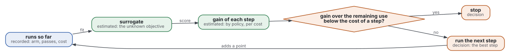

# Review: what the literature says, by strand

Step 2. Surveys and textbooks first, then the seminal works, strand by strand. A number read in an abstract is marked (secondary) where the abstract is a summary. Grades are those of the standard.

## The loop

```dot
// The loop of Bayesian optimisation as the project reads it. Colours: blue what is recorded, green what is estimated,
// orange the decision, each named in its box.
digraph the_loop {
  graph [rankdir=LR, nodesep=0.4, ranksep=0.5, bgcolor="white", pad=0.2, fontname="Inter"];
  node  [shape=box, style="rounded,filled", fontname="Inter", fontsize=13, margin="0.2,0.1", penwidth=1.5, fontcolor="#1F2328"];
  edge  [fontname="Inter", fontsize=11, color="#3D434B", fontcolor="#55575F", penwidth=1.3, arrowsize=0.8];
  D [label=<<b>runs so far</b><br/><font point-size="11" color="#55575F">recorded: arm, passes, cost</font>>, fillcolor="#E8EEF8", color="#2F5DA8"];
  S [label=<<b>surrogate</b><br/><font point-size="11" color="#55575F">estimated: the unknown objective</font>>, fillcolor="#E6F2EA", color="#2E7D4F"];
  A [label=<<b>gain of each step</b><br/><font point-size="11" color="#55575F">estimated: by policy, per cost</font>>, fillcolor="#E6F2EA", color="#2E7D4F"];
  Q [label=<<b>gain over the remaining use<br/>below the cost of a step?</b>>, shape=diamond, style="filled", fillcolor="#FBEDE4", color="#B4541A", margin="0.05,0.05"];
  X [label=<<b>stop</b><br/><font point-size="11" color="#55575F">decision</font>>, fillcolor="#FBEDE4", color="#B4541A"];
  N [label=<<b>run the next step</b><br/><font point-size="11" color="#55575F">decision: the best step</font>>, fillcolor="#FBEDE4", color="#B4541A"];
  D -> S [label=" fit"];
  S -> A [label=" score"];
  A -> Q;
  Q -> X [label=" yes"];
  Q -> N [label=" no"];
  N -> D [label=" adds a point"];
}
```

Graphviz source

The strands below follow the figure: the surrogate and the policies (1 to 4), cost (5), the stop (6), and what a project adds (7).

## Strand 0: existing reviews

- Shahriari 2016 reviews Bayesian optimisation as a way to tune the many design choices of a system without a person in the loop (secondary, abstract).
- Frazier 2018 is a tutorial. Bayesian optimisation suits objectives that take minutes or hours to evaluate, continuous domains of fewer than 20 dimensions, and noisy evaluations (abstract).
- Garnett 2023 is a textbook on optimising expensive objective functions (abstract).
- Greenhill 2020 compares Bayesian optimisation with the design of experiments for adaptive experiments (abstract).
- Bubeck 2012 and Lattimore 2020 are the survey and the textbook of bandits. Russo 2018 is the tutorial on Thompson sampling.
- Settles 2009, Chaloner 1995 and Rainforth 2024 cover active learning and Bayesian experimental design. Peherstorfer 2018 surveys multi-fidelity methods.
- No review joins Bayesian optimisation with evaluators that are agents and an objective that is partly a person's judgment.

## Strand 1: the loop and the standard policy

- Mockus 1975 set the Bayesian method for seeking an extremum. Jones 1998 made it a standard method with a surrogate and expected improvement (secondary: the records carry no abstract).
- Snoek 2012: the choices of the Gaussian-process prior and its inference can decide success or failure. Tuned this way, the method reaches or passes expert-level tuning on a set of benchmarks (abstract).
- Bergstra 2012: randomly chosen trials beat a grid for hyperparameter search (abstract, in part). Random search is the null baseline.
- Turner 2021: a challenge ran optimisers without human intervention on held-out objectives, with random search and open-source packages as baselines. Its title states that Bayesian optimisation beat random search (abstract in part).
- Reading: the loop is a surrogate, an acquisition function and a rule to stop. Grade: supported with caveat, measured on tuning problems and not on projects.

## Strand 2: value of information and the knowledge gradient

- Howard 1966: information is worth what it changes in the decision it informs (secondary, opening of the abstract).
- Frazier 2008: the knowledge-gradient policy myopically maximises the expected rise in the value of what is known. It is optimal for one period, and in the limit as the horizon grows (abstract).
- Frazier 2009: with correlated beliefs the policy is optimal in special cases and has bounded suboptimality in the others. It also maximises a continuous function (abstract).
- Reading: the knowledge gradient scores a step by what it changes in the final choice, not by the chance of beating the best value. Grade: proved under normal beliefs and known noise, which a project does not have.

## Strand 3: bandits and regret

- Bubeck 2012: a bandit balances exploring new options and exploiting known ones, and is judged by regret (abstract).
- Auer 2002 gave finite-time regret bounds for the upper-confidence-bound index (secondary, record only).
- Srinivas 2010 bounds the regret of GP-UCB by the maximal information gain, which ties optimisation to experimental design (abstract).
- Gittins 1979: an index rule is optimal for a class of bandit and search problems (abstract).
- Li 2018: Hyperband treats tuning as a pure-exploration bandit that gives resources to random configurations. It reports over an order-of-magnitude speedup against Bayesian optimisation methods on a suite (abstract, secondary).
- Reading: a project's steps are experiments, not products, so the aim is the best arm at the end, not the payoff along the way. That is simple regret or best-arm identification, not cumulative regret. Grade: convention, argued from the setting.

## Strand 4: active learning and experimental design

- Settles 2009 surveys query strategies for learning with few labels (secondary, record only).
- Chaloner 1995 gives one decision-theoretic view in which design criteria are cases of expected utility (abstract).
- Rainforth 2024 reviews how recent advances overcome the computational cost of Bayesian experimental design (abstract).
- Reading: to learn a function, the utility of a step is information. To find its maximum, it is the value of the best decision after the step. The machinery is the same: the expected utility of the next measurement. Grade: theory.

## Strand 5: cheap and dear evaluators, and cost

- Kennedy 2000 combines expensive runs of a complex code with cheap runs of simpler versions, with Gaussian processes (abstract).
- Kandasamy 2016: a multi-fidelity bandit that uses cheap approximations to drop poor regions achieves better regret than strategies that ignore them, in theory and in tests (abstract).
- Peherstorfer 2018 surveys models of varying cost and fidelity for optimisation and inference (abstract).
- Snoek 2012 divides expected improvement by the cost of the experiment. Lee 2020 measures convergence by time, energy or money, on 20 problems (abstract).
- Xie 2024 links cost-aware optimisation to the Pandora's box problem, whose optimal rule is a Gittins index, usable as an acquisition function (abstract).
- Reading: a cheaper agent or a smaller test set is a low-fidelity evaluator. The cost of a step is part of the policy. Grade: supported with caveat, proved for the models and tested on benchmarks.

## Strand 6: when to stop

- Weitzman 1979 and Ferguson 1989 (linked): classic stopping needs a known distribution of what the next look brings.
- Makarova 2022: stop when the suboptimality of the target is dominated by the statistical error of estimating it. The rule reached a better trade-off between test performance and time on real tuning problems (abstract).
- Nguyen 2017 bounds the regret of expected improvement over the best observed value and derives a stopping condition (abstract, in part).
- Optuna 2026 implements the rule of Makarova 2022: stop when the estimated room for improvement falls below the statistical error. Its page marks the module as deprecated since version 4.9.0.
- Xie 2024: in Pandora's box the Gittins index also gives the optimal point to stop.
- Reading: the surrogate supplies the distribution of what the next step brings. This is what the [convergence review](../convergence/review.md) did not find for one run. Grade: supported with caveat, measured on tuning problems, and only as good as the surrogate.

## Strand 7: what a project adds to a benchmark function

- Bogunovic 2016: when the reward function varies in time, resetting or gradually forgetting old data beats classical GP-UCB, which treats stale and fresh data alike (abstract). The drift there is outside the policy. No source was found for a function that the steps themselves change.
- Zheng 2023b: strong language-model judges match human preferences at over 80% agreement, and show position, verbosity and self-enhancement biases (abstract).
- Vaccaro 2024 (linked, secondary): humans with AI did worse than the better of the two, Hedges g = -0.23.
- Astudillo 2020: when the utility is learned from pairwise preferences, its estimation errors can yield a poor design. The method keeps the uncertainty and offers a menu (abstract).
- Liu 2024c: a language model helps most when observations are sparse, for warm starts and for the surrogate (abstract).
- Yang 2023: a model proposes solutions from earlier ones and their values. Its prompts beat human-designed prompts by up to 8% on one benchmark and up to 50% on another (abstract, secondary).
- Lu 2024b: a system of agents runs research from idea to paper, at under $15 a paper, with an automated reviewer near human scores (abstract, secondary; the authors' claim about their own system).
- Reading: each difference has a literature, but none joins them. Grade: supported with caveat for each part, not found for the whole.

## Strand 8: practice and reference implementations

- Balandat 2020 describes BoTorch, a framework for Monte-Carlo Bayesian optimisation (abstract).
- BoTorch 2026 documents acquisition functions as expectations over the posterior, with expected improvement among them. Its reference lists knowledge gradient, upper confidence bound, a multi-fidelity knowledge gradient and noisy expected improvement.
- Optuna 2026 offers random, tree-structured Parzen and Gaussian-process samplers, and the terminator above.
- Ax 2026 builds on BoTorch for adaptive experiments such as A/B tests, and supports early-stopping evaluations. It scores below the threshold.
- Practice is graded convention, untested. No adoption count was collected.
